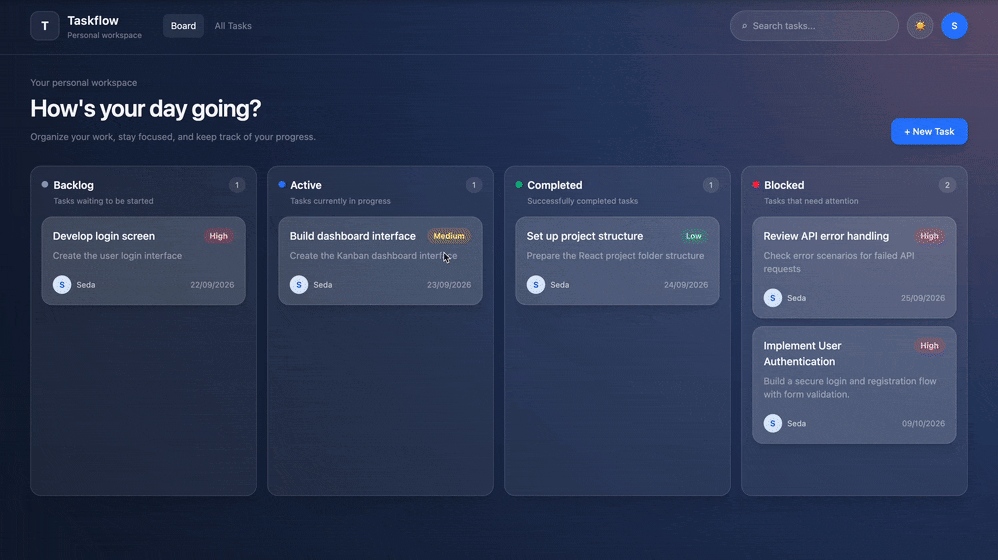

# TASKFLOW – Task Management Kanban Board

TASKFLOW is a responsive task management application built with React and JavaScript. It provides an intuitive Kanban board to organize tasks, track progress, and manage daily workflows.

The application supports full CRUD operations, drag-and-drop task management, real-time search, and persistent local storage.

## Demo

A quick overview of TASKFLOW's Kanban board, drag-and-drop functionality, and task management features.


<p align="center">
  
</p>

**Live Demo:** https://taskflow-nexus.netlify.app/

Features

- **Kanban Board:** Organize tasks across four columns: Backlog, Active, Completed, and Blocked.
- **Task Management:** Create, view, edit, and delete tasks.
- **Drag & Drop:** Move tasks between columns to update their status.
- **Task Search:** Filter tasks by title, description, or assignee.
- **Form Validation:** Validate required fields and input lengths.
- **All Tasks View:** Browse tasks in a responsive table or mobile card layout.
- **Dark & Light Themes:** Switch themes with preferences saved in LocalStorage.
- **Persistent Tasks:** Keep task changes after page refresh using LocalStorage.
- **Responsive Design:** Optimized layouts for desktop, tablet, and mobile devices.

## Tech Stack

- React
- JavaScript (ES6+)
- Vite
- Redux Toolkit
- React Redux
- React Router
- Tailwind CSS
- HTML5 Drag and Drop API
- Browser LocalStorage API


## Getting Started

### Prerequisites

- Node.js
- npm

### Installation

Clone the repository:

```bash
git clone https://github.com/sedaahi/taskflow-kanban.git
```

Navigate to the project directory:

```bash
cd taskflow-kanban
```

Install dependencies:

```bash
npm install
```

Start the development server:

```bash
npm run dev
```

Open the local URL displayed in your terminal.

### Production Build

```bash
npm run build
```

The production-ready files will be generated in the `dist` directory.


## Project Structure

```text
src/
├── components/      # Reusable UI components
├── pages/           # Board and All Tasks pages
├── store/           # Redux store and task slice
├── utils/           # Shared utility functions
├── App.jsx          # Application routes and layout
├── index.css        # Global styles and theme variables
└── main.jsx         # Application entry point
```

## Data Persistence

TASKFLOW currently uses Redux Toolkit for application state management and browser LocalStorage for data persistence.

Tasks and theme preferences are stored locally in the user's browser. No backend connection is required to run this version.

## Future Roadmap

TASKFLOW is planned to evolve into a full-stack, multi-team task and project management platform.

Planned features include:

- **Backend & Database:** Node.js/Express REST API integration with persistent database storage.
- **Authentication & Roles:** Secure login and role-based access for team leaders and members.
- **Team Management:** Create and manage multiple teams, projects, and team members.
- **Task Assignment:** Allow team leaders to assign tasks, set priorities, and track progress.
- **Team Dashboards:** Provide dedicated views for team leaders and members.
- **Reporting & Analytics:** Track project progress, task completion, and team performance.
